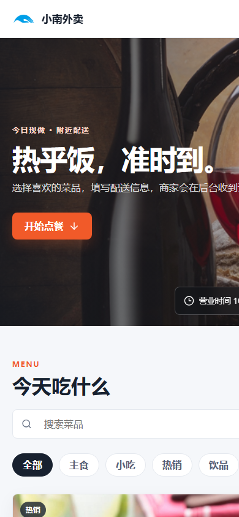
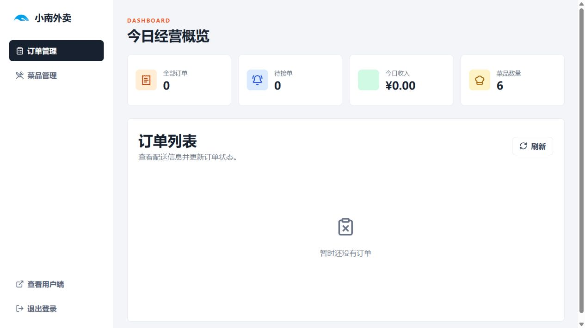
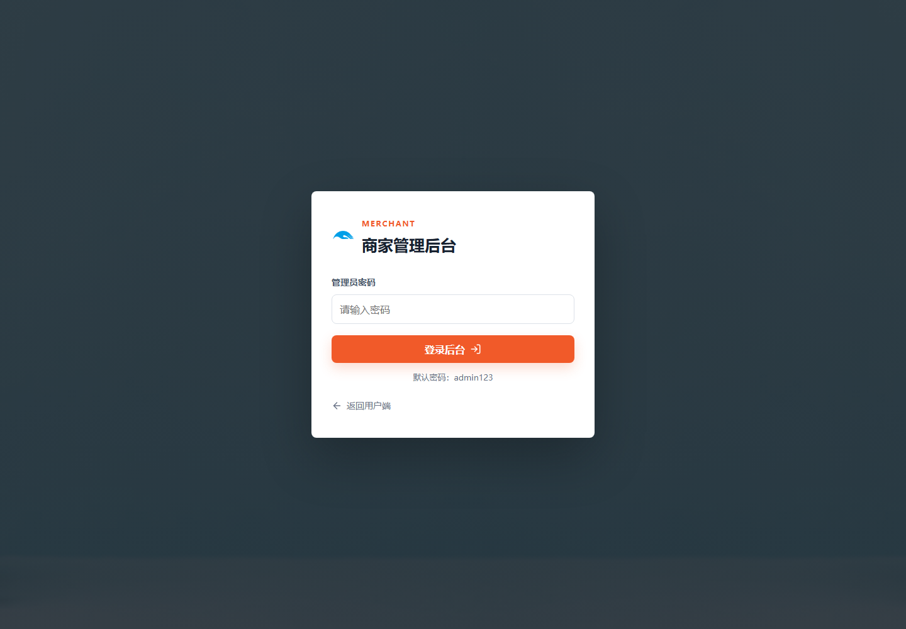

<div align="center">
  
  <h1>小南外卖</h1>
  <p>一个简单、清爽、可以自己和朋友一起用的外卖点餐系统。</p>
  <p>
    
    
    
    
    
  </p>
</div>

参考了课程点餐项目的用户端与管理端结构，但去掉了 MySQL、Redis、Node 和复杂权限依赖。下载后只需要 JDK 17，即可在自己电脑上运行。

## 页面预览

### 用户端


手机访问会自动适配：



### 管理端

查看订单、收入统计并维护菜品：



管理员登录页：



## 已实现功能

用户端：

- 浏览、分类筛选和搜索菜品
- 加入购物车、修改数量
- 填写姓名、手机号、配送地址和备注
- 提交订单并生成订单号

管理端：

- 管理员密码登录
- 查看全部订单、待接单数量和今日收入
- 查看顾客、手机号、地址、备注和菜品明细
- 更新订单状态：待接单、制作中、配送中、已完成、已取消
- 新增、编辑、上下架和删除菜品

## 技术栈

- Java 17
- Spring Boot 3.3.5
- Spring JDBC
- H2 文件数据库
- 原生 HTML、CSS、JavaScript
- Lucide 图标（页面通过 CDN 加载，图标加载失败不影响主要功能）

## 项目结构

```text
xiaonan-takeout/
├─ src/main/java/com/waimai/
│  ├─ WaimaiApplication.java       # 启动类与首次数据初始化
│  └─ WaimaiController.java        # 用户端和管理端 API
├─ src/main/resources/
│  ├─ static/                      # 用户端、管理端和图片资源
│  ├─ application.yml              # 端口、数据库和管理员配置
│  └─ schema.sql                   # 数据表结构
├─ docs/images/                    # README 页面截图
├─ pom.xml
├─ start.cmd
└─ start.ps1
```

## 本地运行

### 环境要求

只需要安装：

- JDK 17

项目自带 Maven Wrapper，不需要单独安装 Maven。

检查 Java：

```powershell
java -version
```

看到 Java 17 即可继续。

### 方式一：直接运行

Windows 下双击 `start.cmd`，或在 PowerShell 执行：

```powershell
cd xiaonan-takeout
.\mvnw.cmd spring-boot:run
```

首次运行会下载 Maven 依赖，时间取决于网络。启动成功后出现：

```text
Tomcat started on port 8080
Started WaimaiApplication
```

### 方式二：打包成 JAR 后运行

```powershell
cd xiaonan-takeout
.\mvnw.cmd clean package
java -jar .\target\waimai-order-1.0.0.jar
```

### 访问地址

用户端：

```text
http://localhost:8080/
```

商家后台：

```text
http://localhost:8080/admin.html
```

默认管理员密码：

```text
admin123
```

## 数据说明

- 首次启动会自动创建 6 个示例菜品。
- 数据保存在项目目录的 `data/` 文件夹中。
- 管理员新增的菜品、订单和状态修改在重启后仍会保留。
- 想恢复初始状态，停止程序后删除 `data/` 文件夹，再重新启动。

注意：`data/` 已加入 `.gitignore`，不会上传到 GitHub，朋友拉取代码后会得到一套新的干净数据。

## 修改管理员密码

编辑 [application.yml](src/main/resources/application.yml)：

```yaml
app:
  admin-password: admin123
  admin-token: waimai-admin-demo-token
```

如果是公开部署，建议同时修改密码和 token。当前实现适合个人使用、课程演示和局域网使用，不适合直接作为商业生产系统。

## 发给朋友使用

### 同一个 Wi-Fi

1. 在运行项目的电脑上查看局域网 IP：

```powershell
ipconfig
```

找到 `IPv4 地址`，例如 `192.168.1.20`。

2. 保持项目运行。
3. 让朋友在同一 Wi-Fi 下访问：

```text
http://192.168.1.20:8080/
```

如果无法访问，检查 Windows 防火墙是否允许 Java 访问专用网络。

### 公网访问

项目目前运行在自己的电脑上，默认不直接暴露到公网。要让不同网络的朋友访问，可以后续部署到云服务器，或使用内网穿透工具。部署前请先修改管理员密码和 token，并将 H2 控制台关闭。

## 从 GitHub 克隆

仓库地址：

```text
https://github.com/nan896/xiaonan-takeout
```

克隆并启动：

```powershell
git clone https://github.com/nan896/xiaonan-takeout.git
cd xiaonan-takeout
.\mvnw.cmd spring-boot:run
```

如果后续修改了代码，可以这样提交：

```powershell
git add .
git commit -m "update project"
git push
```

## API 简表

| 方法 | 地址 | 说明 |
| --- | --- | --- |
| GET | `/api/shop/dishes` | 查询用户端菜品 |
| GET | `/api/shop/categories` | 查询菜品分类 |
| POST | `/api/shop/orders` | 提交订单 |
| POST | `/api/admin/login` | 管理员登录 |
| GET | `/api/admin/summary` | 管理端统计 |
| GET | `/api/admin/orders` | 查询订单 |
| PATCH | `/api/admin/orders/{id}/status` | 更新订单状态 |
| GET | `/api/admin/dishes` | 查询全部菜品 |
| POST | `/api/admin/dishes` | 新增菜品 |
| PUT | `/api/admin/dishes/{id}` | 修改菜品 |
| DELETE | `/api/admin/dishes/{id}` | 删除菜品 |

## 素材说明

示例菜品和横幅图片参考了原课程项目的演示素材，仅用于学习和本地演示。如果要公开商业化使用，建议替换为自己拥有版权的图片。
